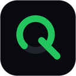

<div align="center">



# AI-Quota

**Universal AI Account & Quota Manager across VS Code, Antigravity IDE, Cursor, and VSCodium.**

Manage, monitor, and switch multiple AI accounts across Antigravity, Google Cloud Code, Gemini API, GitHub Copilot, and OpenAI Codex without repeated browser authentication or lost telemetry.

[](tests/)
[](apps/vscode-extension/)
[](LICENSE)
[](#security--privacy)

</div>

---

## Overview

**AI-Quota** makes it seamless to work with multiple AI provider accounts (Google Antigravity, Gemini API, Cloud Code, GitHub Copilot, OpenAI Codex) without having to manually log out and repeat browser authentication every time.

It pairs a dedicated **IDE Sidebar & Status Bar** with a fast **Local-First Agent & Web Dashboard** (binding strictly to `127.0.0.1`), allowing you to track active quotas (5-hour, weekly, model limits), view real-time countdowns, predict exhaustion times, configure webhook alerts, and switch accounts safely with instant verification.

---

## Compatibility

- **Editors**: Visual Studio Code, Google Antigravity Standalone IDE, Cursor, VSCodium, and other VS Code-compatible editors.
- **Providers & Extensions**: Google Antigravity (Hub & CLI), Google Cloud Code, Gemini API, GitHub Copilot, OpenAI Codex, and Google Cloud.
- **Platforms**: Windows (with native Windows Credential Manager / DPAPI), macOS (Keychain), Linux (Secret Service).

---

## Features

### 👤 Account Management & Switching
- **Saved Accounts**: Store multiple accounts with custom labels, color tags, notes, and group categories (*Work*, *Personal*, *Project Alpha*, etc.).
- **Safe Switching with Verification**: Instant credential swapping with post-switch validation (`activeAccount == requestedAccount`). Never reports success unless actively verified.
- **Token Vault (Local-First)**: Stores credentials locally via native OS Credential Storage (DPAPI on Windows, Keychain on macOS). Switches sessions without opening browser login tabs.
- **Active Account Protection**: Soft-deletion model ensures historical quota analytics are preserved even if an account is removed.

### 📊 Quota Tracking, Matrix & Alerts
- **Real-Time Usage**: Live progress bars and percentages for short-window (e.g. 5-hour) and weekly request limits across all models.
- **Reset Timers**: Exact countdowns showing when quota buckets refresh (e.g., `↺ 1h 42m`).
- **Universal Quota Matrix**: Side-by-side comparative grid viewing remaining quotas across all accounts and time windows simultaneously in both the IDE webview and browser dashboard.
- **Prediction Engine**: Velocity-based forecasting calculating your consumption burn rate, exhaustion ETA, risk levels (*Healthy*, *Warning*, *Critical*), and recommending the best account to use.
- **Low-Quota Webhook Alerts**: Automatic webhook triggers (Discord, Slack, n8n, custom webhooks) dispatched in background threads whenever quota dips below your configured threshold (e.g., 20%).
- **History & Analytics**: Visual charts and one-click data export to **CSV** or **JSON**.

### 💻 Editor Integration & Status Bar
- **Status Bar Item**: Compact live quota indicator (`AI-Quota 84% · 1h 42m`) with color-coded alerts (green ≥ 60%, amber < 30%, red < 15%).
- **Dedicated Activity Bar Sidebar**: Full dashboard panel with live SSE connection status, prediction chips, account cards, and inline label/note editing.
- **Quick-Pick Account Switcher**: Select and switch accounts directly via the Command Palette sorted by highest remaining quota.
- **Provider Truth Separation**: Strict provider isolation ensures metrics from different providers (Antigravity, Copilot, Gemini) are never intermixed or corrupted.

---

## Commands

All commands are accessible from the Command Palette (`Ctrl+Shift+P` / `Cmd+Shift+P`):

| Command | Description |
|---|---|
| **AI-Quota: Open Dashboard** | Opens the complete local web dashboard (`http://127.0.0.1:8765`) |
| **AI-Quota: Switch Account** | Quick-pick account switcher sorted by highest remaining quota |
| **AI-Quota: Show Quota Matrix** | Opens full-screen cross-account × cross-window quota grid webview |
| **AI-Quota: Sync Quota Data** | Manually trigger synchronization across all local provider adapters |
| **AI-Quota: Show Diagnostics** | Inspect local health, SQLite WAL status, and provider telemetry |
| **AI-Quota: Save Current Account** | Register a new account / project directly from your editor |
| **AI-Quota: Show Status** | View current account quota summary notification |
| **AI-Quota: Sign In** | Open the authentication onboarding flow |
| **AI-Quota: Sign Out** | Safe local account removal |
| **AI-Quota: Re-authenticate** | Re-validate credentials for the active provider |

---

## Configuration

Customize settings via your editor's `settings.json`:

```json
{
  // URL of the local AI-Quota agent
  "ai-quota.agentUrl": "http://127.0.0.1:8765",

  // Show live quota indicator in the status bar
  "ai-quota.showStatusBar": true,

  // Polling interval in seconds to refresh quota data
  "ai-quota.pollInterval": 60,

  // Low quota warning alert threshold percentage
  "ai-quota.lowQuotaThreshold": 20
}
```

---

## Security & Privacy

- **Local Storage Only**: Account credentials and tokens stay strictly on your machine in the editor's OS-backed Secret Storage (`vscode.SecretStorage` / Windows DPAPI / macOS Keychain).
- **Zero Remote Secret Policy**: Credentials, session tokens, passwords, and cookies are **never** uploaded to any external server or stored in plain SQLite.
- **Localhost Boundary**: Agent binds strictly to `127.0.0.1`. Never exposes ports to `0.0.0.0` unless explicitly directed.
- **No Third-Party Telemetry**: Zero analytics trackers, zero data harvesting, and zero metric fabrication.

See [SECURITY.md](SECURITY.md) for our comprehensive security architecture.

---

## Installation

### From VSIX Package

Download the latest `ai-quota-2.0.0.vsix` from [GitHub Releases](https://github.com/Kesicode/AI-Quota/releases).

#### Install via Editor GUI:
1. Open the **Extensions** view (`Ctrl+Shift+X` or `Cmd+Shift+X`).
2. Click the `···` menu at the top right of the extensions pane.
3. Select **Install from VSIX...** and choose `ai-quota-2.0.0.vsix`.

#### Install via CLI:
```bash
# Visual Studio Code
code --install-extension ai-quota-2.0.0.vsix

# Google Antigravity IDE
antigravity --install-extension ai-quota-2.0.0.vsix

# Cursor
cursor --install-extension ai-quota-2.0.0.vsix

# VSCodium
codium --install-extension ai-quota-2.0.0.vsix
```

#### One-Click Windows Script:
```bat
scripts\install_extension.bat
```

---

## Quick Start (Local Backend)

The IDE extension connects seamlessly to the local AI-Quota engine:

### Windows
```bat
run.bat
```

### macOS / Linux
```bash
chmod +x run.sh && ./run.sh
```

- **Dashboard**: [http://127.0.0.1:8765](http://127.0.0.1:8765)
- **API Documentation**: [http://127.0.0.1:8765/api/docs](http://127.0.0.1:8765/api/docs)

---

## Development

```bash
# Run backend test suite (59 unit & integration tests)
python -m pytest tests/ -v

# Install extension dependencies
cd apps/vscode-extension
npm install

# Compile TypeScript and bundle with esbuild
npm run build

# Package production VSIX
npx @vscode/vsce package --no-dependencies
```

---

## License

- **Author**: [Kesicode](https://github.com/Kesicode)
- **License**: [MIT License](LICENSE)
- **Disclaimer**: Not affiliated with or endorsed by Google LLC. Google Antigravity is a trademark of Google LLC.
