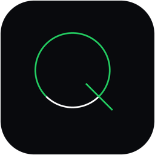

<div align="center">



# AI-Quota

**Universal AI Account & Quota Manager for VS Code, Google Antigravity IDE, Cursor & Web**

*Manage, monitor, predict, and auto-switch multiple AI accounts across Google Antigravity 2.0, Gemini API, GitHub Copilot, OpenAI Codex, and Google Cloud — from a dedicated IDE extension and local-first dashboard.*

[](apps/vscode-extension/)
[](https://open-vsx.org/extension/Kesicode/ai-quota)
[](tests/)
[](https://python.org)
[](#security--privacy)
[](LICENSE)

[**Install via Open VSX**](https://open-vsx.org/extension/Kesicode/ai-quota) · [**Overview**](#overview) · [**Compatibility**](#compatibility) · [**Features**](#features) · [**Commands**](#commands) · [**Configuration**](#configuration) · [**Installation**](#installation) · [**API Reference**](#api-reference) · [**Security**](#security--privacy)

</div>

---

<a id="overview"></a>
## Overview

**AI-Quota** makes it effortless to work across multiple AI accounts without having to manually log out, repeat browser authentication, or run into surprise rate limits in the middle of a coding session.

It provides a unified, local-first engine (`127.0.0.1:8765`) combined with a native IDE sidebar view and status bar integration to:
- Track active quotas across all models and windows (5-hour, weekly, monthly, and context windows).
- View precise live countdown timers until quota buckets reset (`↺ 1h 42m`).
- Auto-switch accounts on low quota trigger so you never get interrupted during coding sessions.
- Pin your preferred model directly into the IDE status bar.
- Predict exhaustion time with a velocity forecasting engine.
- Instantly switch between saved accounts with safe capability checks and verification.
- Receive webhook and desktop notifications when any quota falls below your safety threshold.

---

<a id="compatibility"></a>
## Compatibility

- **Supported Editors**: Visual Studio Code (1.85.0+), Google Antigravity Standalone IDE 2.0+, Cursor, VSCodium, and other VS Code-compatible forks.
- **Provider Adapters**:
  - **Google Antigravity & Antigravity 2.0 Standalone IDE** (Native RPC process auto-discovery, 5h + weekly buckets, instant credential swapping)
  - **Gemini API** (Free & Pay-as-you-go tier quotas)
  - **Google Cloud Code & Cloud Shell**
  - **GitHub Copilot**
  - **OpenAI / Codex**
- **Operating Systems**: Windows (with native Credential Manager / DPAPI Token Vault), macOS (Keychain), and Linux (Secret Service).

---

<a id="features"></a>
## Features

### 🔄 Account Management & Safe Switching
- **Saved Accounts**: Store multiple AI provider accounts with custom labels, group categories (*Work*, *Personal*, *Dev*, *Production*), color tags, and priority ordering.
- **One-Click Account Addition (`+` button)**: Register new provider accounts directly from the sidebar header.
- **Instant Token Vault (Windows)**: Swaps credentials locally via Windows Credential Manager / DPAPI, switching sessions without opening browser login windows every time.
- **Verified Switching**: Strict verification protocol ensures `activeAccount == requestedAccount` before reporting success.
- **Active Account Protection**: Protects against accidental deletion of the active account while signed in.

### ⚡ Auto-Switch on Low Quota
- Automatically detects when your active account's quota drops below the warning threshold (default 20%).
- Intelligently switches your active session to the account with the highest remaining quota.
- Configurable cooldown timer prevents flapping between borderline accounts.
- One-click toggle in the sidebar (`⚡ Auto: ON/OFF`).

### 📊 Quota Tracking, Matrix & Alerts
- **Real-Time Usage**: Live progress bars and percentages across 5-hour, daily, and weekly limits with model-specific precision.
- **Reset Timers**: Shows exact countdowns (`↺ 1h 42m`) until quota windows refresh.
- **Quota Matrix**: Side-by-side comparison grid (`GET /api/v1/matrix` & IDE Webview) displaying all accounts × all windows simultaneously with color-coded health indicators.
- **Velocity Prediction Engine**: Predicts quota consumption rate, calculates exact exhaustion ETA, and highlights the best account to use.
- **Low-Quota Alerts & Webhooks**: Desktop notifications and automated background webhooks (Slack, Discord, custom HTTP) whenever quota drops below your configured threshold (default 20%).
- **History & CSV Export**: Detailed time-series analytics with one-click CSV and JSON data export.

### 💻 Editor Integration & Status Bar
- **Sidebar Panel**: Live status dot (🟢 live, 🟡 stale, ⚪ offline), prediction chips, account recommendation banner, and inline label/note editor.
- **Status Bar Readout**: Real-time quota indicator (`$(pulse) AI-Quota 84% · 1h42m`) with dynamic warning colors (≤20% warning, ≤10% critical).
- **Pin Model to Status Bar**: Pin a specific model or quota window directly in the status bar for permanent glanceability.
- **Zero Window Reloads**: Signals IDE backend components without needing a complete editor reload.

### 🌐 Proxy & Network Control
- **Localhost Guaranteed Bypass**: Internal communication with local Language Servers and Hubs (`127.0.0.1`) strictly bypasses proxy chains.
- **Proxy Support**: Configurable direct, system default, or custom manual HTTP/SOCKS5 proxy paths.
- **SSL Verification Toggle**: Configurable strict SSL for enterprise or custom inspection environments.

---

<a id="commands"></a>
## Commands & Shortcuts

All commands are accessible from the Command Palette (`Ctrl+Shift+P` / `Cmd+Shift+P`):

| Command | Shortcut | Description |
|---|---|---|
| `AI-Quota: Focus View` | — | Opens and focuses the sidebar quota dashboard |
| `AI-Quota: Status Bar Menu` | `Alt+A` / `Option+A` | Quick account switcher sorted by highest remaining quota |
| `AI-Quota: Refresh Quota` | `Alt+Shift+A` / `Option+Shift+A` | Manually triggers provider sync and updates telemetry |
| `AI-Quota: Quick Quota View (QuickPick)` | `Alt+Q` / `Option+Q` | Pop-up list showing live quota breakdown across all models |
| `AI-Quota: Pin Model to Status Bar` | — | Pin a specific model's quota into the status bar |
| `AI-Quota: Unpin Model from Status Bar` | — | Revert status bar to aggregate account quota |
| `AI-Quota: Quota Matrix (All Accounts)` | — | Opens full-screen cross-provider comparison matrix webview |
| `AI-Quota: Switch Account` | — | Switch active session to a saved account with safety confirmation |
| `AI-Quota: Add Account` | — | Register a new account / provider identity |
| `AI-Quota: Save Current Account` | — | Registers and stores an account into the local registry |
| `AI-Quota: Clear Stored Token Vault...` | — | Purge encrypted credentials from Secret Storage / DPAPI |
| `AI-Quota: Export Saved Accounts...` | — | Export saved accounts to portable JSON backup |
| `AI-Quota: Import Saved Accounts...` | — | Import accounts from JSON backup file |
| `AI-Quota: Export Quota Analytics...` | — | Export quota history and analytics to CSV or JSON |
| `AI-Quota: Restart Backend Process` | — | Terminate and reload the local language server process |
| `AI-Quota: Start Local Engine` | — | Launch the local background engine |
| `AI-Quota: Open Dashboard` | — | Opens the full browser-based dashboard (`http://127.0.0.1:8765`) |
| `AI-Quota: Show Status` | — | Displays current active account and quota breakdown notification |
| `AI-Quota: Diagnostics` | — | Inspects agent health, SQLite database info, and provider status |
| `AI-Quota: Settings` | — | Open AI-Quota extension settings |

---

<a id="configuration"></a>
## Configuration

Customize behavior directly in your editor's `settings.json` or via **Settings** (`Ctrl+,`) → Search **`AI-Quota`**:

```json
{
  // Local agent URL (default: http://127.0.0.1:8765)
  "ai-quota.agentUrl": "http://127.0.0.1:8765",

  // UI polling interval in seconds
  "ai-quota.pollInterval": 30,

  // Low quota warning notification threshold (percentage)
  "ai-quota.notificationThreshold": 20,

  // Automatically switch to fullest account when below threshold
  "ai-quota.autoSwitch": false,

  // Minimum minutes to wait between automatic account switches
  "ai-quota.autoSwitchCooldownMinutes": 5,

  // Status bar format string
  "ai-quota.statusBarFormat": "$(pulse) AI-Quota {percent}% · {reset}",

  // Background provider full-sync interval in minutes
  "ai-quota.syncIntervalMinutes": 5
}
```

---

<a id="installation"></a>
## Installation

### 1. From Open VSX Registry (Recommended)

Search for **`AI-Quota`** in your editor's Extensions marketplace (`Ctrl+Shift+X` / `Cmd+Shift+X`), or install via terminal:

```bash
# Google Antigravity IDE
antigravity --install-extension Kesicode.ai-quota

# Visual Studio Code / Cursor / VSCodium
code --install-extension Kesicode.ai-quota
cursor --install-extension Kesicode.ai-quota
codium --install-extension Kesicode.ai-quota
```

Open VSX Registry page: [**open-vsx.org/extension/Kesicode/ai-quota**](https://open-vsx.org/extension/Kesicode/ai-quota)

### 2. From VSIX Package

Download the latest `ai-quota.vsix` from [**GitHub Releases**](https://github.com/Kesicode/AI-Quota/releases/latest).

#### Install via IDE GUI:
1. Open the Extensions view (`Ctrl+Shift+X` or `Cmd+Shift+X`).
2. Click the `···` menu at the top-right of the Extensions view.
3. Select **Install from VSIX...** and select `ai-quota.vsix`.

#### Install via CLI:
```bash
code --install-extension ai-quota.vsix
```

---

<a id="quick-start"></a>
## Quick Start (Local Backend)

The IDE extension connects seamlessly to the local AI-Quota engine:

### Windows
```bat
run.bat
```

### macOS / Linux
```bash
chmod +x run.sh && ./run.sh
```

- **Dashboard**: [http://127.0.0.1:8765](http://127.0.0.1:8765)
- **API Documentation**: [http://127.0.0.1:8765/api/docs](http://127.0.0.1:8765/api/docs)

---

<a id="api-reference"></a>
## 📡 API Reference

Base URL: `http://127.0.0.1:8765` · OpenAPI Docs: `/api/docs`

| Method | Endpoint | Description |
|---|---|---|
| `GET` | `/api/v1/health` | Service health, engine version, and uptime |
| `GET` | `/api/v1/accounts` | All registered accounts with quota breakdown |
| `POST` | `/api/v1/accounts` | Register a new account / project identity |
| `DELETE` | `/api/v1/accounts/{id}` | Remove account and stored history |
| `POST` | `/api/v1/accounts/{id}/switch` | Execute verified account switch |
| `PATCH` | `/api/v1/accounts/{id}/label` | Update label, color tag, group, notes, and priority |
| `GET` | `/api/v1/matrix` | Universal cross-account × cross-window quota grid |
| `GET` | `/api/v1/predictions` | Velocity-based forecasts, ETA to exhaustion, and best-account pick |
| `GET` | `/api/v1/history` | Historical quota time-series (CSV or JSON export) |
| `GET` | `/api/v1/providers` | Provider adapter status, capabilities, and telemetry health |
| `POST` | `/api/v1/sync` | Trigger isolated, fault-tolerant sync across all adapters |
| `GET` | `/api/v1/webhooks/config` | Retrieve webhook alert parameters |
| `PUT` | `/api/v1/webhooks/config` | Update webhook target URL and quota threshold |
| `POST` | `/api/v1/webhooks/fire` | Evaluate and trigger quota threshold alerts |

---

<a id="architecture"></a>
## 🏗️ Architecture

```
AI-Quota/
├── app/
│   ├── main.py                  # FastAPI app with lifespan manager
│   ├── routes/
│   │   └── v1.py                # REST & SSE streaming endpoints
│   ├── services/
│   │   ├── account_service.py   # Account lifecycle & state management
│   │   ├── sync_manager.py      # Background provider sync & webhook auto-fire
│   │   └── prediction_engine.py # Quota velocity & exhaustion forecasting
│   └── providers/               # Provider adapter implementations
│       ├── antigravity_2.py     # Antigravity 2.0 Language Server RPC auto-discovery
│       ├── antigravity_cli.py   # CLI-level session quota extraction
│       ├── cloud_code.py        # Google Cloud Code adapter
│       ├── gemini.py            # Google Gemini API adapter
│       ├── codex.py             # OpenAI Codex adapter
│       ├── copilot.py           # GitHub Copilot adapter
│       └── google_cloud.py      # Google Cloud IAM / project quota adapter
│
├── static/                      # Web dashboard (Obsidian Dark + Emerald design)
│   ├── index.html               # Multi-tab SPA interface
│   ├── app.js                   # Client state, quota matrix, and label modal
│   └── dashboard.css            # Responsive dark theme
│
├── apps/vscode-extension/       # VS Code / Antigravity IDE extension
│   ├── src/                     # TypeScript extension source
│   │   ├── sidebar/             # Sidebar Webview Provider (Quota & Accounts)
│   │   ├── agent_client.ts      # HTTP client for local daemon
│   │   ├── commands.ts          # Extension command registrations
│   │   └── extension.ts         # Extension lifecycle entry point
│   └── dist/extension.js        # Production bundle
│
├── tests/                       # Complete pytest suite (62/62 passing)
└── scripts/                     # Packaging (.vsix) & auto-installation scripts
```

---

<a id="security--privacy"></a>
## 🔒 Security & Privacy

AI-Quota is engineered under a strict **Zero Remote Secret Storage Policy**:

- **Local-Only Storage**: Account tokens and credentials stay on your machine in the OS-backed Secret Storage (Windows Credential Manager / DPAPI, macOS Keychain, Linux Secret Service).
- **Never in SQLite**: Passwords, OAuth tokens, and API keys are **never** stored in plaintext inside the database; only opaque `credential_reference` keys are kept locally.
- **Strict 127.0.0.1 Binding**: The daemon binds exclusively to localhost (`127.0.0.1`). It never listens on `0.0.0.0` unless explicitly commanded.
- **No Telemetry / No Remote Transmission**: Your usage metrics and credentials are never transmitted to third parties or cloud servers.
- **Target Scoping**: Specifically scoped to local IDE processes and official credentials without touching unrelated system entries.

See [**SECURITY.md**](SECURITY.md) for full audit details.

---

<a id="development"></a>
## Development

```bash
# Run backend test suite (62 unit & integration tests)
python -m pytest tests/ -v

# Install extension dependencies
cd apps/vscode-extension
npm install

# Compile TypeScript and bundle with esbuild
npm run build

# Package production VSIX
npx @vscode/vsce package --no-dependencies
```

---

## License

- **Author**: [Kesicode](https://github.com/Kesicode)
- **License**: [MIT License](LICENSE)
- **Open VSX**: [open-vsx.org/extension/Kesicode/ai-quota](https://open-vsx.org/extension/Kesicode/ai-quota)
- **Disclaimer**: Not affiliated with or endorsed by Google LLC. Google Antigravity is a trademark of Google LLC.
